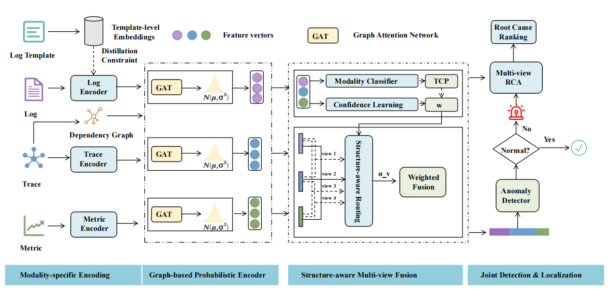

# STRIDE: Structure-Aware Multi-View Interaction for End-to-End Multimodal Failure Diagnosis in Microservice Systems

### Architecture



​	The figure above shows the overall framework of **STRIDE**, an end-to-end multimodal framework for joint anomaly detection and root cause localization in microservice systems. STRIDE takes metrics, traces, and logs as inputs, learns structure-aware multimodal representations, and produces both anomaly detection results and service-level root cause rankings. The framework consists of four modules: (1) Modality-specific Encoding, which extracts modality-aware representations from metrics, traces, and logs, where log templates are enhanced through semantic distillation with template-level LLM embeddings; (2) Graph-based Probabilistic Encoder, which models service dependency structures using GAT and learns uncertainty-aware multimodal representations in a probabilistic latent space; (3) Structure-aware Multi-view Fusion, which performs confidence-guided adaptive routing across multiple cross-modal interaction views to capture diagnosis-oriented modality relationships; and (4) Joint Detection & Localization, which jointly conducts anomaly detection and multi-view root cause localization to produce service-level root cause rankings.


### Environment

The repository has some important dependencies below

- Python 3.12
- Pytorch 2.4
- Qwen3-Embedding
- Drain3
- Numpy 1.24
- scikit-learn  1.3


### Dataset

The publicly available dataset used in this paper, named socialnetwork, can be downloaded from <https://doi.org/10.5281/zenodo.7615393>. In addition, we have open-sourced the dataset we collected ourselves, which is publicly available at <https://doi.org/10.5281/zenodo.21023678> and <https://doi.org/10.5281/zenodo.21024164>.


### Training

The training and testing of the model are carried out together. Run the following command, and the model will be able to perform training and testing:

```python
python train_imad_v2
```

